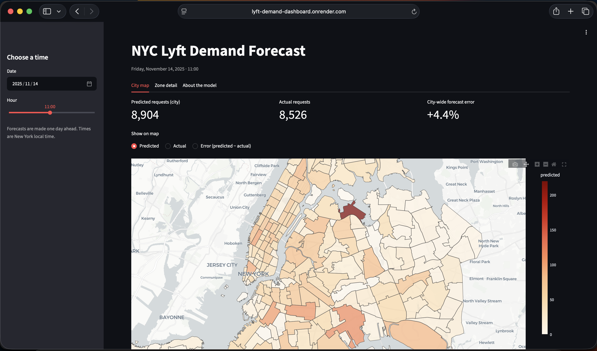
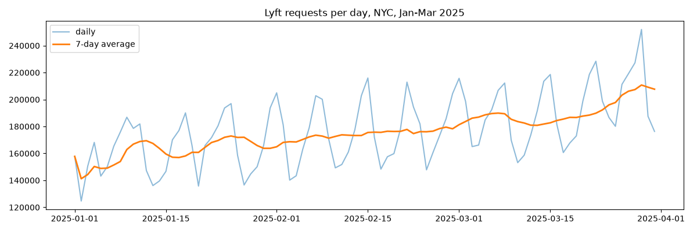
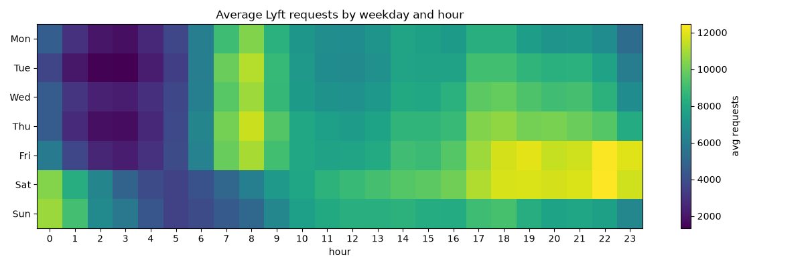
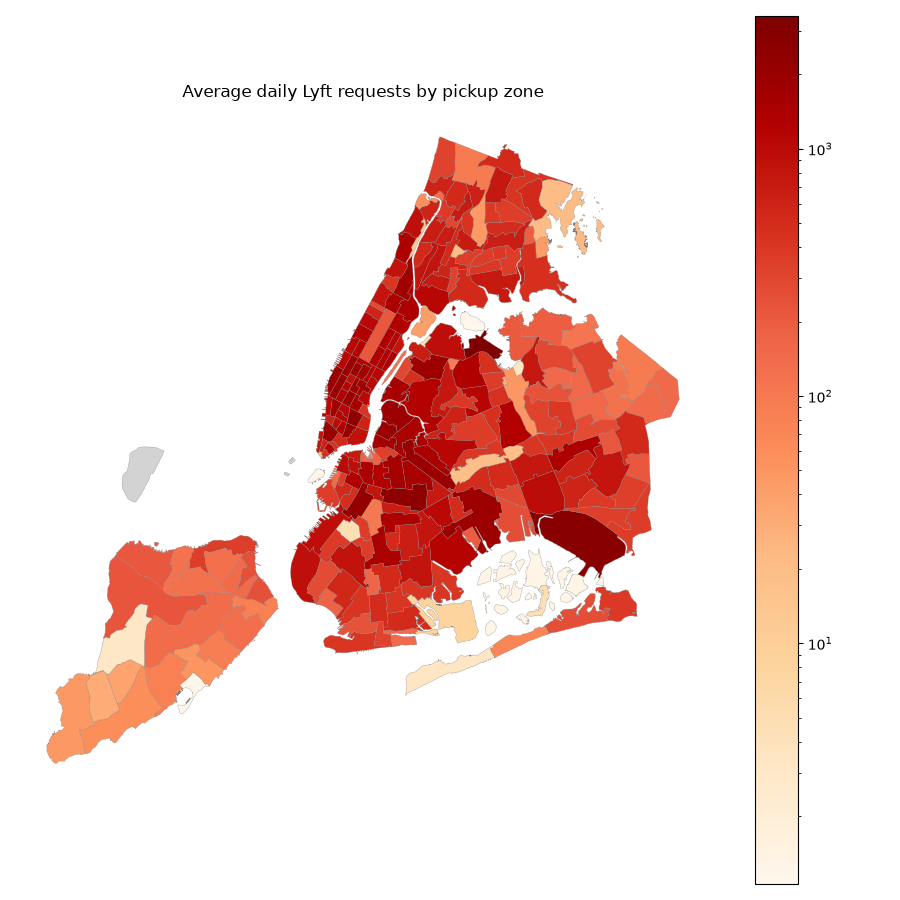
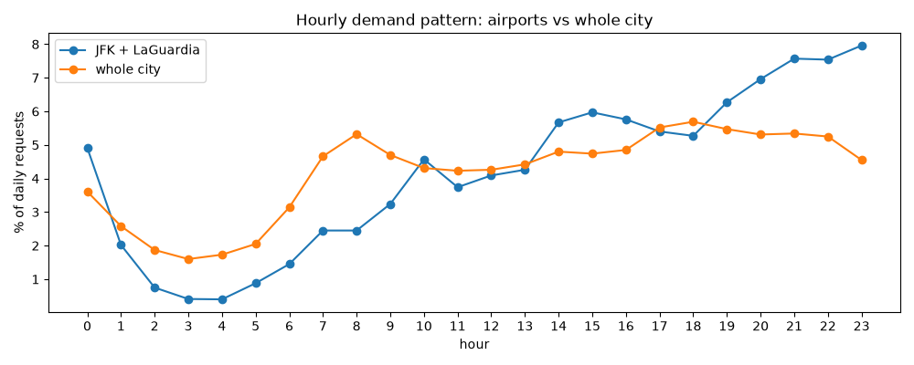
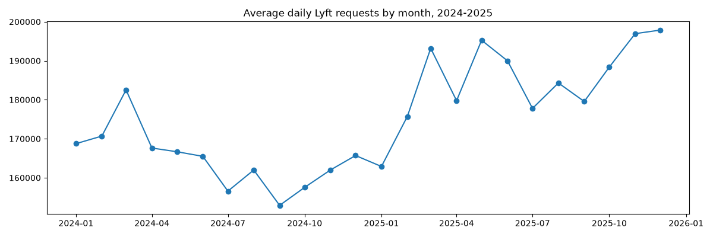

# NYC Lyft Demand Forecasting


Day-ahead forecasts of **hourly Lyft ride requests for 262 New York City taxi zones**, built on 128 million real Lyft trip records. Includes a SQL data pipeline, a LightGBM forecasting model with time-based evaluation, a REST API and an interactive map dashboard.

**Live demo:** [Dashboard](https://lyft-demand-dashboard.onrender.com) · [API docs](https://lyft-demand-api.onrender.com/docs)*(Free hosting: the first load after a period of inactivity can take about a minute.)*



---

## The problem

Ride-hailing platforms need to know **where and when riders will request trips**, so they can position drivers and set prices before demand arrives. This project forecasts the number of Lyft requests in every NYC taxi zone for every hour, **24 hours in advance**, which is the horizon a driver-planning system would use.

## Results

Test period: October – December 2025 (never used for training or model selection).

| Model | MAE (requests per zone-hour) | WAPE |
|---|---|---|
| Baseline: same hour yesterday | 9.61 | 31.1% |
| Baseline: same hour last week | 7.94 | 25.7% |
| **LightGBM (Poisson)** | **5.85** | **18.9%** |

The model reduces error by **26%** compared with the strongest naive baseline.

*WAPE (weighted absolute percentage error) = total absolute error / total actual demand. It is used instead of MAPE because 7.4% of zone-hours have zero requests.*

## Data

- **Source:** [NYC TLC High Volume For-Hire Vehicle trip records](https://www.nyc.gov/site/tlc/about/tlc-trip-record-data.page), filtered to Lyft (`hvfhs_license_num = HV0005`)
- **Period:** January 2024 – December 2025, 128M ride requests
- **Unit:** demand measured at `request_datetime`, the moment a rider asks for a ride (pickup time would mix in driver supply)

## Approach

### 1. SQL pipeline (DuckDB)
- Downloaded and aggregated each month to zone × hour counts, then deleted the raw file, so the ~12 GB of raw data never had to sit on disk at once
- Built a **complete zone × hour grid** (262 zones × 17,544 hours = 4.6M rows) with `CROSS JOIN` + `LEFT JOIN` + `COALESCE`, so hours with zero demand are explicit rows rather than missing ones. Without this the model would never learn that demand can be zero, and lag features would point to the wrong hours
- Validated the result: exact row count, totals cross-checked against an independent calculation

### 2. Exploratory analysis
| | |
|---|---|
|  |  |
|  |  |

Findings that shaped the model:
- **Weekly cycle:** Saturday demand is about 35% higher than Monday; the weekday 8 AM commute peak disappears on weekends, while Friday and Saturday nights are the busiest hours of the week
- **Strong concentration:** 55 of 261 zones produce half of all demand; Manhattan alone accounts for 40%
- **Airports behave differently:** JFK and LaGuardia have no morning peak and are busiest from 9 to 11 PM, following flight arrivals rather than commuting
- **Growth:** demand in 2025 is 10–20% higher than in 2024, on top of seasonal patterns, so the model needs features that tell it the *current* level



### 3. Features (no data leakage)
Because forecasts are made 24 hours ahead, **every lag feature is at least 24 hours old**. Using last hour's demand would look great offline and fail in production.

- Calendar: hour of day, day of week, hour of week, month
- Holidays: US federal holidays, special days (Christmas Eve, New Year's Eve, Black Friday, Halloween), holiday season, and a flag for when last week's value fell on a holiday
- Demand history per zone (SQL window functions with `PARTITION BY zone_id`): same hour yesterday, last week, two weeks ago; mean of the previous week

### 4. Model and evaluation
- LightGBM with a **Poisson objective** (non-negative counts with many zeros)
- **Time-based split:** train Jan 2024 – Aug 2025, validate Sep 2025 (early stopping), test Oct – Dec 2025. A random split would let the model "see the future" and overstate accuracy

## Error analysis and what I tried

The worst test days were all calendar events: Halloween, Christmas week, New Year's Eve and the days around Thanksgiving.

| Experiment | Result |
|---|---|
| Holiday / special-day features | Fixed some days (Black Friday, the Tuesday after Thanksgiving) but made Halloween worse. Each special day appears only once in the training data, so the model memorised 2024's Thursday Halloween and misapplied it to 2025's Friday. Net change: negligible |
| Weather (Open-Meteo) and 4-week averages | No meaningful gain on the validation month. Weather slightly helped rainy hours, but September 2025 had only 44 rainy hours and no holidays, so it could not show the value of either feature |

**Decisions:** I stopped tuning against the test set to keep the reported number honest, and kept the simpler model when new features did not help on validation. Next steps would be more years of history (each holiday seen several times), a city events calendar (e.g. the NYC Marathon), and rolling-origin backtesting across several seasons instead of a single validation month.

## Architecture

```
NYC TLC trip data ──► DuckDB pipeline ──► zone × hour panel ──► LightGBM model
                                                                     │
                       Streamlit dashboard ◄── FastAPI REST API ◄────┘
                       (map, zone detail)      (/predict, /predict/day, /predict/city)
```

The dashboard holds no model; it only calls the API. Both services run in Docker and are deployed separately on Render.

**Production note:** the API serves pre-computed features for the test period so forecasts can be compared with actual demand. In a live system, a nightly job would ingest new trips and compute tomorrow's features.

## Project structure

```
├── app/main.py                 # FastAPI service
├── dashboard/app.py            # Streamlit dashboard
├── models/lgbm_demand.txt      # trained model
├── serving/                    # features for Oct–Dec 2025, zone lookup, zone shapes
├── tests/test_api.py           # API tests + model accuracy regression test
├── day1_explore.py … day4_*.py # pipeline, analysis, features, training, experiments
├── Dockerfile                  # API image
├── Dockerfile.dashboard        # dashboard image
├── docker-compose.yml
└── .github/workflows/ci.yml    # tests + Docker builds on every push
```

## Run locally

```bash
docker compose up --build
```

Dashboard: http://localhost:8501 · API docs: http://localhost:8000/docs

Run the tests:

```bash
pip install -r requirements-dev.txt
pytest -v
```

The tests include a **regression test** that fails if model accuracy drifts from the expected WAPE, which catches silent errors such as a wrong model file or broken features.

## Tech stack

Python · SQL (DuckDB) · pandas · LightGBM · GeoPandas · Plotly · FastAPI · Streamlit · Docker / Docker Compose · pytest · GitHub Actions · Render
